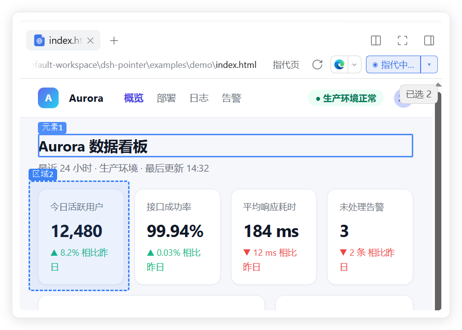
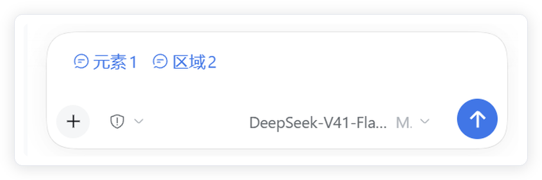
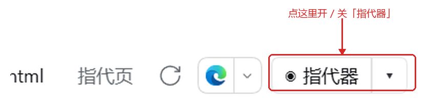

# dsh-pointer（指代器）

在 DeepSeek Harness 的文档预览里直接「指代」UI 元素：**左键选中元素、右键拖拽框选区域**，
把结构化信息 + **源码行号** 送进对话，模型据此精确定位要改的代码。

## 演示

预览里**左键选元素、右键拖拽框选区域**，编号标记与输入框 chip 一一对应：



选中的目标会变成输入框里的引用 chip，随消息一起发送：



## 收录信息

- **一句话价值**：在 DSH 的 HTML 预览里直接圈选 DOM 元素 / 拖框选区域，把选择器与 `文件:行号` 精确交给 agent —— 不用再向模型描述「那个卡片」。
- **能力分类**：界面与体验（interface）
- **安装命令**：
  - 源码安装（无需 NPM）：`dsh plugin --profile desktop add github:Phonky-Chou/dsh-pointer`
  - 本地安装：`dsh plugin --profile desktop add <本仓库绝对路径>`
- **兼容与运行要求**：DeepSeek Harness `0.2.0-rc.2`（Windows 桌面版）；无需构建、无第三方依赖
- **许可证**：MIT
- **权限与外部服务**：不发起任何外部网络请求、无遥测。host 半边读取被预览的本地文件及其相对资源，并在 `127.0.0.1` 上注册两条本地路由；状态写入 `~/.dsh/`（`pointer-context.json` / `pointer-settings.json` / `pointer-debug.json`）。

## 能力

- **自注册预览实现**：插件注册自己的 `html` / `htm` 渲染器（`priority: 'extension'`），
  内置预览仍可从渲染器下拉切回 —— 不侵入、可卸载。
- **沙箱探针**：内容渲染在 `srcdoc` 沙箱 iframe 里，探针用 `postMessage` 回传；
  用户页面无法接触 DSH 页面（不降级为 `allow-same-origin`）。
- **左键选元素 / 右键框选区域**：预览内保留带编号的高亮标记，编号与输入框 chip 一一对应。
- **相对资源内联**：外链 CSS → `<style>`、图片/字体 → `data:` URL、CSS 内 `url()` 也一并内联，
  因此带外部依赖的真实项目也能正常预览。
- **源码定位**：元素 → `文件:行:列`；内联后会把 `data:` URL 还原成原始引用再匹配源码。
- **双通道投递**：输入框引用 chip（主）+ host 路由上下文块（兜底）；发送后消息里仍显示为 chip。
- **悬停联动**：输入框里悬停 chip，预览中对应标记变为黄色光晕。

## 大文件与容量上限

DSH 的文档读取层对单页有 32 MB 上限（`error.tooLarge`），超过时 `bytes-complete`
预览拿不到内容。本插件默认的 **「指代页」** 使用 `loading: 'renderer'` 模式解决这个问题：

- 正文在读取任何字节**之前**就挂载，由插件自己的 host 路由直接读盘，**不受 DSH 那 32 MB 限制**
- 不需要手动切换渲染器，小文件和大文件是同一条路

渲染器下拉里另有一个 **「指代页·兼容模式」**（`bytes-complete`），由 DSH 自己投递文件字节，
仅作兜底排障用，正常不需要选。

### 大文件上限（默认 100 MB，可调）

host 处理文档的内存开销约为文件大小的 **6~7 倍**，因此默认加了一道保护：

| 文件大小 | 行为 |
|---|---|
| ≤ 100 MB | 正常打开 |
| > 100 MB | 不读取，直接显示「文件过大」提示页（保护宿主进程） |

位置：预览头部开关旁的 **「▾」菜单 → 大文件上限**，可选 `50 / 100 / 200 / 500 MB` 或 **不限**。
设置保存在 `~/.dsh/pointer-settings.json`，对所有预览生效。

实测参考（host 侧，同一台机器）：

| 文件大小 | host 耗时 | host 内存 |
|---|---|---|
| 10 MB | 193 ms | 103 MB |
| 41.3 MB | 752 ms | ~300 MB |
| 100 MB | 1375 ms | 691 MB |

### 其它容量限制

| 项目 | 上限 |
|---|---|
| 外部资源内联总预算 | 8 MB（超出部分保留原始路径，可能显示裂图） |
| 行号可用（host 回传源码） | 源码 ≤ 8 MB，更大的文件只有路径、没有行号 |
| 单个元素上下文 HTML | 8 KB（区域项 2 KB，渲染进上下文时 600 字符） |
| pick 请求体 | 2 MB |

## 环境要求

- Windows
- DeepSeek Harness 桌面版（验证于 `0.2.0-rc.2`），并**至少启动过一次**
- 无需构建、无第三方依赖（`lib/` 是可直接运行的产物）

## 安装

### 方式一：插件管理（最简单，推荐）

1. DSH 左侧栏点 **插件** → 右上角 **添加插件**
2. 输入本仓库地址：

   ```
   https://github.com/Phonky-Chou/dsh-pointer
   ```

   国内网络可用 Gitee 镜像（**必须带 `.git` 结尾**）：

   ```
   https://gitee.com/z_xl7974/dsh-pointer.git
   ```

   > pnpm 只把 `.git` 结尾或 `git+https://` 开头的地址当 git 仓库；
   > 漏掉 `.git` 会被当成压缩包去抓，安装报 `ERR_PNPM_TARBALL_EXTRACT`。
   >
   > 如果 HTTPS 地址失败，**不要**改用 `github:Phonky-Chou/dsh-pointer` 这种速记 ——
   > 实测在部分网络下它会因 `git ls-remote` 失败而报错；`https://` 全写形式反而更稳。

3. 安装完成后点对话框里的**立即启用**（没有这个按钮就忽略，见下一步）
4. **重启 DeepSeek Harness**；重启后到 **插件 → dsh-pointer** 确认开关是打开状态
   （开关关闭时插件只是「已安装」，预览不会出现指代器）

### 方式二：一键脚本（命令行）

```powershell
git clone https://github.com/Phonky-Chou/dsh-pointer.git
cd dsh-pointer
powershell -ExecutionPolicy Bypass -File .\install.ps1
```

脚本会自动定位 DSH 安装目录、调用 DSH 自带 CLI 装进 `desktop` profile。
其它 profile / 卸载：

```powershell
powershell -ExecutionPolicy Bypass -File .\install.ps1 -Profile desktop
powershell -ExecutionPolicy Bypass -File .\install.ps1 -Uninstall
```

### 方式三：手动

```sh
dsh plugin --profile desktop add <repo路径或 github:Phonky-Chou/dsh-pointer>
```

Gitee 镜像要写全（带 `.git`）：

```sh
dsh plugin --profile desktop add https://gitee.com/z_xl7974/dsh-pointer.git
```

装完都需要**重启 DeepSeek Harness**：host 与客户端包都在启动时加载。

## 使用

1. 在 DSH 右侧栏用**预览**方式打开一个 `.html` 文件（默认会走「指代页」渲染器）。
2. 点顶部工具栏的 **`◉ 指代器`** 进入指代模式 —— 按钮位置：

   

3. **左键**点页面元素 → 输入框出现「元素N」；**右键拖拽**框选区域 → 出现「区域N」。
4. 把 chip 写进句子发送；模型收到选择器、标签、文本、outerHTML 与 `文件:行:列`。

`▾` 展开角标可查看探针状态、本次已选数量，并可一键清除全部标记。

> **第一次打开文件时**：DSH 会先在对话里给出一个**蓝色文件链接**，点它才会在右侧打开预览面板。
> 指代器只存在于预览面板里 —— 所以看不到 `◉ 指代器` 时，先确认预览面板已经打开。

## 已知限制

- 目前只接管 `html` / `htm`；`md` / `txt` / `svg` / PDF 等尚未接入（后续按 provider 扩展）。
- 探针只覆盖主 frame，不穿透嵌套 iframe；Shadow DOM 只能选到宿主元素。
- 位图、canvas 内绘制的图形没有 DOM 元素可指代（只能框选区域坐标）。
- 单个元素的 `outerHTML` 在上下文块里截断到 2KB。
- 仅验证于 Windows + DeepSeek Harness `0.2.0-rc.2`。

## 开发

```
lib/index.js     host 半边：上下文块 + `/dsh-pointer/pick`、`/dsh-pointer/inline` 路由
lib/inline.js    host 侧相对资源内联（fs 直接读盘）
lib/client.js    client 半边：预览实现、探针、chip 投递、渲染层 chip 装饰
docs/DESIGN.md   技术底座设计（分层、协议、类型扩展方案）
examples/with-assets/  资源内联验证夹具（外链 CSS / SVG / CSS 内 url()）
examples/demo/         截图演示页（Aurora 数据看板，中性内容）
workbuddy/        WorkBuddy 版（MCP server + 扩展面调研，见该目录 README）
install.ps1       可选的一键安装/卸载脚本
```

## License

MIT
